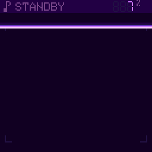

# CHJukebox: ATMlib Jukebox

Five songs in five styles, played by ATMlib (the Arduboy's four-voice
tracker synth, ported to the CHGame) on the one buzzer pin, while a piano
roll that runs ahead of the sound, each voice's own scope, the mix and a
tracker view show what plays. A jukebox on a secret agent's watch: the
apps' instrument panel, in neon violet.

## Controls

| Where | Button | Action |
|---|---|---|
| List | UP / DOWN | Pick a song (hold to repeat) |
| | A | Play it (or open the player on the one playing) |
| | B | Stop the music |
| | START | SYNTH / BEEP engine |
| Player | A | Pause / play |
| | B | Back to the list (the music plays on) |
| | LEFT / RIGHT | The song before / after |
| | UP / DOWN | DRIVE: the mix's gain before it clips, x0.5 to x4 |
| | SELECT | The view: DECK, SCOPE, TRACKER |
| | START | SYNTH / BEEP engine |

## The songs

| Song | Style | Key, tempo | What to listen for |
|---|---|---|---|
| Clockwork Invention | Baroque two-part invention | D minor, 112 BPM | A subject answered at the octave, a circle-of-fifths episode, a dominant pedal, a Picardy third |
| The Brass Kettle | Irish jig in 6/8 | D major, 117 BPM | AABB with cuts, rolls and slides the second time round, pipe drones, a bodhran |
| Velvet Strut | Disco-funk | E dorian, 109 BPM | Slap bass with a chromatic walk-up, chicken-scratch guitar, a hook, a breakdown |
| Circuit Breaker | Drum & bass | F minor, 172 BPM | A chopped breakbeat with rolls, a reese bass, notes echoed like a dub delay |
| Rain on Glass | Lo-fi jazz ballad | Db major, 75 BPM | Extended chords, a walking bass, a muted-trumpet melody, brushes and crackle |

## How to use it

The list shows each song's style, key and tempo; the one playing has a
little equaliser that moves with its voices, and the one highlighted has
its liner note running along the bottom. In the player the status bar
names the section the song is in (its cues) with the tempo in
seven-segment digits, and the gauge under it is the way through the loop.

- **DECK**: the piano roll. The song runs a second time, ahead of the
  sound, so notes arrive from the right and light up as they cross the
  line; chords played as arpeggios fill out into bands; the drums have a
  lane of their own. Under it each voice's note, waveform and level, and
  the mix as the buzzer gets it.
- **SCOPE**: the mix large, with the last frame's trace behind it, and
  each voice's note, level and pitch in Hz.
- **TRACKER**: a row a sixteenth (an eighth in the jig, a triplet in the
  ballad), the four voices' notes and volumes scrolling through the cursor.

Each song plays its intro and its loop twice, then the next one starts.
DRIVE trades loudness for clipping (x1.5 to start). If the mix sounds
wrong on a board, START switches to **BEEP**: the same songs as plain
square waves, the voices taking turns, the way the CHGame library plays
music.

Install the CHGame board package 0.4.0 or later
([Installing](https://github.com/bateske/CHGame#installing)), open
`CHJukebox.ino` in the Arduino IDE, pick your board (*Tools > Board >
CHGame Rev0* or *CHGame Rev1*, *Tools > USB* **Upload only**) and upload.
The same source builds for both boards. Or take the cart from the
[Releases](https://github.com/bateske/CHJukebox/releases/latest) page;
[BUILDING.md](../BUILDING.md) has the command-line route.

## Developer notes

- **ATMlib, ported** ([src/atm](src/atm/ATMlib.h)): the playroutine is the
  Arduboy's statement for statement (it matches ATMlib's own reference
  model tick for tick on all twelve of its example songs), so a `song.h`
  from an Arduboy sketch plays here unchanged. The mixer runs 15,625 times
  a second in the buzzer timer's update interrupt, from SRAM, into an 8-bit
  PWM at 187.5 kHz; the repetition counter makes one timer both the carrier
  and the sample clock.
- **One source, every board.** Nothing in the sketch names a pin or a timer:
  the synth looks the variant's `PIN_BUZZER` up in its `PinMap_TIM` (TIM1
  channel 2 on Rev0, TIM2 channel 2 on Rev1) and blinks `PIN_LED`, so the
  board picked in the IDE (or `chgame --board`) is the only difference
  between the Rev0 and Rev1 binaries ([src/atm/ATMlib.cpp](src/atm/ATMlib.cpp)).
- **The look-ahead** ([Jukebox.cpp](Jukebox.cpp)): a second score runs the
  same song 96 ticks ahead of the sound, a cell a tick, and every view
  draws from it.
- **The scopes** ([Scope.cpp](Scope.cpp)) are drawn with the mixer's own
  arithmetic from a snapshot of the oscillators, not from recorded samples:
  the voices' scopes stand still at any pitch, the mix's is triggered on the
  lowest voice.
- **The songs are written in Python** ([tools/songs](tools/songs)):
  `make_songs.py` assembles them into ATM commands, plays each through the
  port on the PC and proves that its loop has no seam, and renders WAV
  previews.
- **The library**: `chgame` buttons and pacing, `pal::` with the app's
  palette (the beat flashes the grid), the debug protocol (`H` reports the
  song, tick, section and engine), `chgame/Sizzle`'s banners, and the
  [Agent.h](Agent.h) chrome of CHGame's apps (CHStlView, CHSDtoUSB).
- [NOTES.md](NOTES.md): how the port differs from the Arduboy's, each
  song's brief, the hardware checklist, sizes and open items.

## Credits

ATMlib: Davey Taylor (ATMsynth, after his Squawk), Joeri Gantois (the song
format) and TEAM a.r.g., BSD-3-Clause ([src/atm/LICENSE-ATMlib](src/atm/LICENSE-ATMlib)).
The port, the app and the five songs: MIT ([LICENSE](../LICENSE)). The
3x5 font is Press Play On Tape's (the CHGame library's NOTICE).
