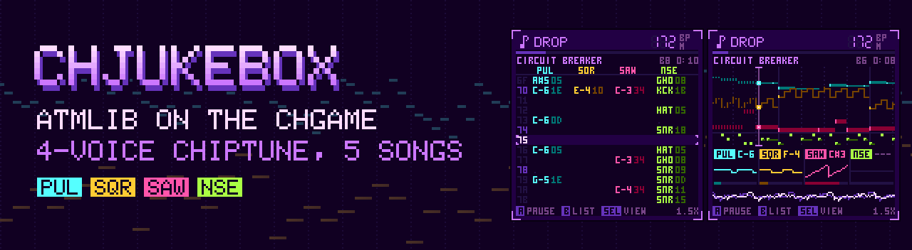
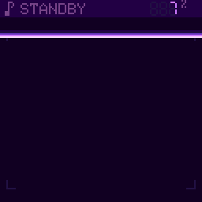

<a id="readme-top"></a>

<div align="center">

<a href="https://github.com/bateske/CHJukebox">
  
</a>

<h3>ATMlib, the Arduboy's four-voice tracker synth, ported to the CHGame handheld</h3>

<p>
  Five songs in five styles, and a visualiser that shows every note before you hear it.<br>
  A 15,625 Hz software synth in a timer interrupt, on one buzzer pin, on a 48 MHz RISC-V with 20 KB of RAM.
</p>

[![Release][release-shield]][release-url] [![Stars][stars-shield]][stars-url] [![Forks][forks-shield]][forks-url] [![Issues][issues-shield]][issues-url] [![MIT License][license-shield]][license-url]

[![Platform][platform-shield]][chgame-url] [![Voices][voices-shield]](#how-it-works) [![Sample rate][rate-shield]](#how-it-works) [![Flash][flash-shield]](#how-it-works) [![RAM][ram-shield]](#how-it-works)

<p>
  <a href="https://github.com/bateske/CHJukebox/releases/latest"><strong>Download the cart »</strong></a>
  <br>
  <br>
  <a href="CHJukebox/README.md">How to use it</a>
  ·
  <a href="CHJukebox/NOTES.md">The port's notes</a>
  ·
  <a href="BUILDING.md">Building it</a>
  ·
  <a href="https://github.com/bateske/CHJukebox/issues/new?labels=bug">Report a bug</a>
</p>

</div>

<details>
  <summary><strong>Table of contents</strong></summary>
  <ol>
    <li><a href="#about-the-project">About the project</a>
      <ul>
        <li><a href="#controls">Controls</a></li>
        <li><a href="#the-songs">The songs</a></li>
        <li><a href="#features">Features</a></li>
        <li><a href="#built-with">Built with</a></li>
      </ul>
    </li>
    <li><a href="#getting-started">Getting started</a></li>
    <li><a href="#how-it-works">How it works</a></li>
    <li><a href="#using-the-port-in-your-own-sketch">Using the port in your own sketch</a></li>
    <li><a href="#writing-songs">Writing songs</a></li>
    <li><a href="#license">License</a></li>
    <li><a href="#acknowledgments">Acknowledgments</a></li>
  </ol>
</details>

## About the project

[ATMlib](https://github.com/T-arg/ATMlib) is the Arduboy's tracker music
engine: four voices (a pulse, a square, a saw and noise) with arpeggios,
slides, vibrato and tremolo, playing songs written as compact command
streams. CHJukebox ports it to the [CHGame][chgame-url] and wraps it in a
jukebox: pick a song, then watch it play as a piano roll that runs ahead of
the sound, as each voice's waveform, as the mix the buzzer gets, or as a
tracker scrolling through its rows.

It is two things at once: an app you can put on the handheld, and an
implementation of what is effectively a library. The port's playroutine is
ATMlib's statement for statement, so a `song.h` written for an Arduboy
plays here unchanged, and its hardware layer asks the board package where
the buzzer is, so one source builds for every CHGame board.

<div align="center">
  
</div>

### Controls

| Where | Button | Action |
|---|---|---|
| Song list | UP / DOWN | Pick a song |
| | A | Play it (or open the player on the one playing) |
| | B | Stop the music |
| Player | A | Pause / play |
| | B | Back to the list (the music plays on) |
| | LEFT / RIGHT | The song before / after |
| | UP / DOWN | DRIVE: the mix's gain before it clips, x0.5 to x4 |
| | SELECT | The view: DECK, SCOPE, TRACKER |
| Both | START | The engine: SYNTH (the real mix) or BEEP (square waves) |

The screens and the engines are explained in the app's own
[README](CHJukebox/README.md).

### The songs

Each was written to a brief, as a songwriter would be given one (the
briefs are in [NOTES.md](CHJukebox/NOTES.md#the-songs-toolssongs) and at
the top of every song's header):

| Song | Style | Key, tempo | What to listen for |
|---|---|---|---|
| Clockwork Invention | Baroque two-part invention | D minor, 112 BPM | A subject answered at the octave, a circle-of-fifths episode, a dominant pedal, a Picardy third |
| The Brass Kettle | Irish jig in 6/8 | D major, 117 BPM | AABB with cuts, rolls and slides the second time round, pipe drones, a bodhrán |
| Velvet Strut | Disco-funk | E dorian, 109 BPM | Slap bass with a chromatic walk-up, chicken-scratch guitar, a hook, a breakdown |
| Circuit Breaker | Drum & bass | F minor, 172 BPM | A chopped breakbeat with rolls, a reese bass, notes echoed like a dub delay |
| Rain on Glass | Lo-fi jazz ballad | D-flat major, 75 BPM | Extended chords, a walking bass, a muted-trumpet melody, brushes and crackle |

All five together are 5,089 bytes.

### Features

- **The whole of ATMlib.** Every effect and function of the Arduboy's
  playroutine: arpeggios, volume and frequency slides, vibrato, tremolo,
  glissando, note cut, transposition, cues, tempo changes, sound effects
  over a song.
- **Four real voices on one pin.** The mix is synthesised 15,625 times a
  second and played as an 8-bit PWM at 187.5 kHz, not time-shared beeps.
- **In tune and in time.** Concert pitch (the Arduboy plays about 75 cents
  flat) and exactly the tempo's ticks a second.
- **A visualiser that sees the future.** A second copy of the song runs 96
  ticks ahead of the sound, so the piano roll and the tracker show what is
  about to play. The scopes are drawn with the mixer's own arithmetic.
- **One source, Rev0 and Rev1.** The board picked in the IDE is the only
  difference between the binaries; the cart carries both.
- **A BEEP engine** for comparison: the same songs as plain square waves,
  the voices taking turns, the way the CHGame library plays music.
- **Songs written in Python**, assembled into ATM commands and proven
  seam-free by playing them through the port itself.

### Built with

[![C++][cpp-shield]][cpp-url] [![Arduino][arduino-shield]][arduino-url] [![RISC-V][riscv-shield]][riscv-url] [![Python][python-shield]][python-url] [![Zig][zig-shield]][zig-url]

The [CHGame][chgame-url] board package with its CHGame and CHGfx libraries,
[ATMlib](https://github.com/T-arg/ATMlib), Python for the songs and the
pictures, Zig's C++ compiler for the song tools, and CHGame's simulator.

<p align="right">(<a href="#readme-top">back to top</a>)</p>

## Getting started

**The cart.** Download `CHJukebox.chgame` from the
[Releases](https://github.com/bateske/CHJukebox/releases/latest) page. It
holds a binary for each board (Rev0 and Rev1), and CHGame's SD menu and
tools pick the right one. Put it on the card with CHGame's tools
(`chgame cart deploy CHJukebox.chgame --card E:\`) and choose JUKEBOX from
the menu.

**From source, in the Arduino IDE:**

1. Install the CHGame board package, **0.4.0 or later**: add
   `https://github.com/bateske/CHGame/releases/latest/download/package_chgame_index.json`
   under *File > Preferences > Additional boards manager URLs*, then
   install *CHGame* in the Boards Manager.
2. Open `CHJukebox/CHJukebox.ino`.
3. Pick your board, *Tools > Board > CHGame Boards > CHGame Rev0* or
   *CHGame Rev1*. Keep *Tools > Peripherals* on **Game** (the default); the
   release builds use *Tools > USB* **Upload only**, though the default
   Serial works too.
4. Upload.

> [!NOTE]
> The songs, the simulator and the release cart have their own tools:
> see [BUILDING.md](BUILDING.md).

<p align="right">(<a href="#readme-top">back to top</a>)</p>

## How it works

| At a glance | |
|---|---|
| Voices | 4: pulse (25%), square, saw, noise |
| Sample rate | 15,625 Hz, from the buzzer timer's update interrupt |
| Output | 8-bit PWM at 187.5 kHz (ARR 255 at 48 MHz; the repetition counter makes an update every 12th period) |
| CPU | about 6% for the mix (estimated), plus about 40 µs per tick, 30-46 ticks a second |
| Fidelity | identical to ATMlib's own reference model, tick for tick, on all twelve of its example songs |
| Flash | 33,120 B (Rev0) / 33,188 B (Rev1) of 50,944 |
| RAM | 17,000 of 18,416 B, plus a 2 KB stack |

**The playroutine** ([`src/atm/ATMlib.cpp`](CHJukebox/src/atm/ATMlib.cpp))
is ATMlib's `ATMlibimpl.h`, statement for statement, with every effect
compiled in. Its quirks are kept on purpose, because songs were written
against them: a volume slide is not clamped at 63, an arpeggio adds the
transposition twice. What does differ is the output and the edges:

| | Arduboy | CHGame |
|---|---|---|
| Output | Timer4's PWM, mixed in its overflow interrupt | The buzzer's timer: 8-bit PWM at 187.5 kHz, a sample every 12th period |
| Tuning | about 75 cents flat | concert pitch: `ATM_NOTE_A4` is 440 Hz |
| Tempo | `15625 / tempo` samples a tick, rounded down | exactly `tempo` ticks a second |
| Silence | a voice at note 0 holds a DC level (a click) | silent; after a quarter of a second of silence the pin rests low |
| The mix | an 8-bit sum that wraps | summed in full, scaled by DRIVE, clipped |
| Safety | a track that runs away hangs the interrupt | a bad call, a missing track or 64 commands without a delay stop the channel |

The mixer, the playroutine and their helpers run from SRAM (about 2.3 KB):
from flash, with three wait states, a tick of four channels could outlast
the 64 µs between samples. Each update writes the sample computed last time
into the preloaded compare register, so every sample lands exactly one
period late.

**One source for every board.** The hardware layer names no pin and no
timer. It looks the variant's `PIN_BUZZER` up in the variant's own
`PinMap_TIM` (the table `analogWrite()` uses), which gives the timer, the
channel and the remap, and lets the core's `pin_function()` put the pin on
it; the beat flashes `PIN_LED`:

| | Rev0 | Rev1 |
|---|---|---|
| Buzzer | PB10, TIM1 CH2: a piezo | PA1, TIM2 CH2: a MOSFET under a magnetic buzzer |
| LED | PB9 | PB10 |
| Backlight | always on | PB9 (CHGfx's; never touched) |

A first version wrote TIM1, PB10 and PB9 directly. Built for Rev1 it
compiled and ran, but switched Rev1's backlight with the drums and played
the music on its LED. Any sketch with register-level sound or LED code will
do the same on a new board; going through the variant's names is what
makes the board menu enough. [NOTES.md](CHJukebox/NOTES.md) has the details.

**The visualiser** ([`Jukebox.cpp`](CHJukebox/Jukebox.cpp),
[`Player.cpp`](CHJukebox/Player.cpp),
[`Scope.cpp`](CHJukebox/Scope.cpp)) runs a second playroutine on the same
song, 96 ticks ahead of the sound, and writes down each voice's nearest note
and volume a tick at a time into a 160-tick ring. The piano roll and the
tracker draw from that ring; the scopes are drawn from a snapshot of the
oscillators with the mixer's own arithmetic, so the picture is the sound.

<p align="right">(<a href="#readme-top">back to top</a>)</p>

## Using the port in your own sketch

Copy [`CHJukebox/src/atm`](CHJukebox/src/atm) into your sketch's `src/`
folder. The API is ATMlib's, with a few additions:

```cpp
#include <CHGame.h>
#include "src/atm/ATMlib.h"
#include "song.h"                   // any ATMlib song: const uint8_t song[] = { ... };

ATMsynth ATM;

ATM_SFX_TRACK(sfxJump, ATM_VOL(40), ATM_SL_VOL((uint8_t)-3), ATM_NOTE_C5, ATM_DELAY(12));

void setup() {
    chgame.boot();
    ATM.play(song);                 // starts the synth on the board's buzzer
}

void loop() {
    ATM.pump(micros());             // the simulator renders the synth here; nothing on the board
    if (!chgame.nextFrame()) return;
    chgame.pollButtons();
    if (chgame.justPressed(A_BUTTON)) ATM.playSfx(sfxJump, CH_ONE);
    if (chgame.justPressed(B_BUTTON)) ATM.playPause();
}
```

- **ATMlib's calls:** `play()`, `playPause()`, `pause()`, `resume()`,
  `stop()`, `muteChannel()`, `unMuteChannel()`, `playSfx()`, `setTempo()`,
  `check()` (cues).
- **The port's:** `setDrive()` (the mix's gain, 16 = x1, 24 by default),
  `setEngine(atm::SYNTH | atm::BEEP)`, `led()`, and for a visualiser
  `snapshot()`, `score()`, `ticks()`, `peak()` and `atm::scoreTick()`, a whole
  second playroutine to run ahead of the sound.
- **What it owns:** the buzzer's timer and pin, and the core's SysTick hook
  (`osSystickHandler`, for BEEP). Do not use the CHGame library's `audio::`
  in the same sketch.
- **Build with *Peripherals: Game*** (the default): the port defines the
  TIM1-TIM3 interrupt handlers itself, and the *Full* option's
  HardwareTimer defines them too.

<p align="right">(<a href="#readme-top">back to top</a>)</p>

## Writing songs

The songs are written in Python with a small assembler,
[`tools/songs/atmgen.py`](CHJukebox/tools/songs/atmgen.py): a part is a
line of notes and commands in ticks (`"L4 D5 E5 F5 | !v30 Bb5:12 =:4"`), and
the assembler cuts each channel into bars, shares the bars that come back
as tracks, and loops the body the hop-free way of ATMlib's README (every
channel's loop track ends with a `GOTO` to itself).
[`make_songs.py`](CHJukebox/tools/songs/make_songs.py) then proves every
song with the port itself, compiled for the PC:

- no channel stops, and every tick of the loop's second and third pass is
  equal to the pass before it (the loop has no seam);
- the call stack stays within 7, and every note within C2..D7;
- the header it writes, compiled against the real `ATMcmds.h`, gives the
  same bytes.

It also renders WAV previews of the board's own samples (`--wav`). The
headers it writes are ordinary ATMlib `song.h` files in `ATM_*` commands,
so they play on an Arduboy too.

<p align="right">(<a href="#readme-top">back to top</a>)</p>

## License

The code, the songs and the documentation of CHJukebox are under the MIT
licence: see [LICENSE](LICENSE).

ATMlib's code in [`CHJukebox/src/atm`](CHJukebox/src/atm) (its
`ATMcmds.h`, and the playroutine the port follows) is under its own BSD
3-Clause licence: see
[`LICENSE-ATMlib`](CHJukebox/src/atm/LICENSE-ATMlib).

<p align="right">(<a href="#readme-top">back to top</a>)</p>

## Acknowledgments

- **[ATMlib](https://github.com/T-arg/ATMlib)** by Davey Taylor
  (ATMsynth, after his [Squawk](https://github.com/stg/Squawk)), Joeri
  Gantois (the song format) and TEAM a.r.g. Its README, part manual and
  part songwriting guide, and its reference model `atmsim.py` made a
  faithful port checkable.
- **[CHGame][chgame-url]**: the board package, the CHGame and CHGfx
  libraries, the simulator and the "secret agent" chrome of its apps.
- The 3x5 font is Press Play On Tape's, the 5x7 Adafruit's GLCD font, both
  through CHGame's libraries.

<p align="right">(<a href="#readme-top">back to top</a>)</p>

<!-- MARKDOWN LINKS & IMAGES -->
[release-shield]: https://img.shields.io/github/v/release/bateske/CHJukebox?style=for-the-badge&color=cc77ff
[release-url]: https://github.com/bateske/CHJukebox/releases/latest
[stars-shield]: https://img.shields.io/github/stars/bateske/CHJukebox?style=for-the-badge&color=55ffff
[stars-url]: https://github.com/bateske/CHJukebox/stargazers
[forks-shield]: https://img.shields.io/github/forks/bateske/CHJukebox?style=for-the-badge&color=55ffff
[forks-url]: https://github.com/bateske/CHJukebox/network/members
[issues-shield]: https://img.shields.io/github/issues/bateske/CHJukebox?style=for-the-badge&color=55ffff
[issues-url]: https://github.com/bateske/CHJukebox/issues
[license-shield]: https://img.shields.io/badge/license-MIT-6633bb?style=for-the-badge
[license-url]: https://github.com/bateske/CHJukebox/blob/main/LICENSE
[platform-shield]: https://img.shields.io/badge/platform-CHGame%20Rev0%20%C2%B7%20Rev1-220044?style=for-the-badge
[voices-shield]: https://img.shields.io/badge/voices-4-ff55aa?style=for-the-badge
[rate-shield]: https://img.shields.io/badge/synth-15%2C625%20Hz-ffcc33?style=for-the-badge
[flash-shield]: https://img.shields.io/badge/flash-33%20KB%20%2F%2050.9%20KB-aaff44?style=for-the-badge
[ram-shield]: https://img.shields.io/badge/RAM-17%2C000%20%2F%2018%2C416%20B-aaff44?style=for-the-badge
[chgame-url]: https://github.com/bateske/CHGame
[cpp-shield]: https://img.shields.io/badge/C++-00599C?style=for-the-badge&logo=cplusplus&logoColor=white
[cpp-url]: https://isocpp.org/
[arduino-shield]: https://img.shields.io/badge/Arduino-00878F?style=for-the-badge&logo=arduino&logoColor=white
[arduino-url]: https://arduino.github.io/arduino-cli/
[riscv-shield]: https://img.shields.io/badge/RISC--V-283272?style=for-the-badge&logo=riscv&logoColor=white
[riscv-url]: https://riscv.org/
[python-shield]: https://img.shields.io/badge/Python-3776AB?style=for-the-badge&logo=python&logoColor=white
[python-url]: https://www.python.org/
[zig-shield]: https://img.shields.io/badge/Zig%20c++-F7A41D?style=for-the-badge&logo=zig&logoColor=black
[zig-url]: https://ziglang.org/
